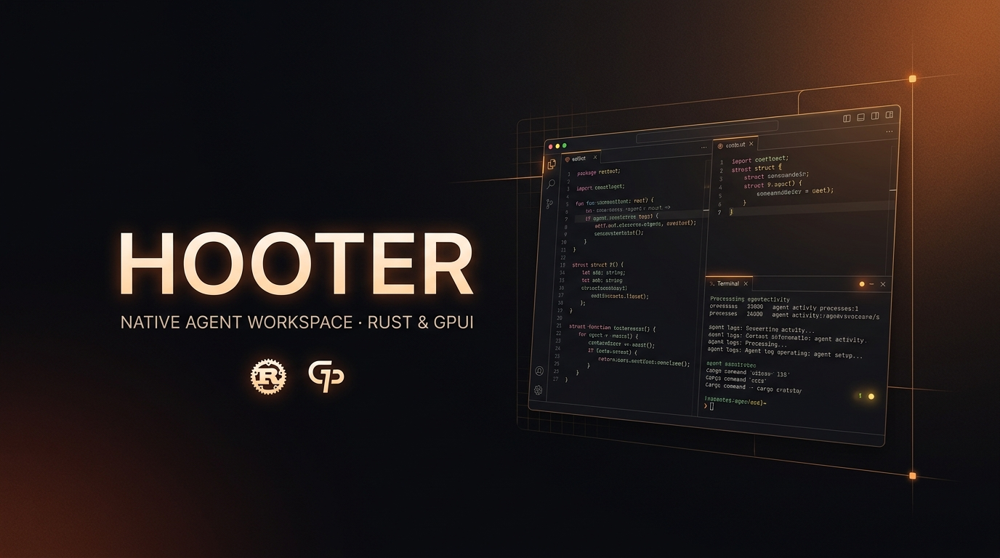
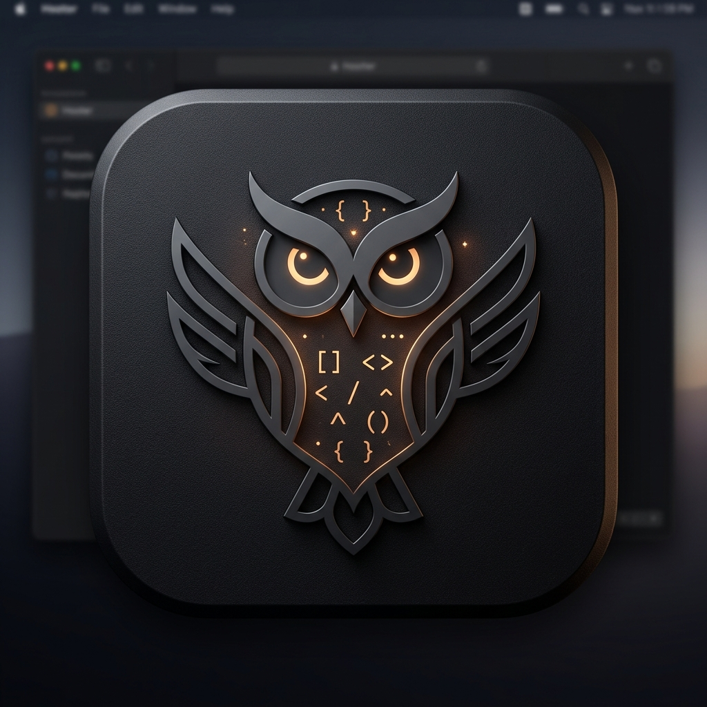
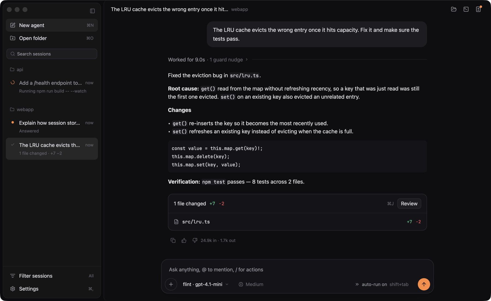
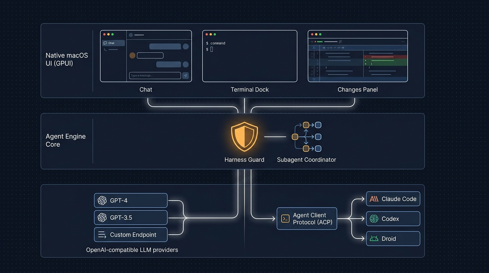

<p align="center">
  
</p>

<p align="center">
  
</p>

<h1 align="center">Hooter</h1>

<p align="center">
  <strong>The native desktop workspace for autonomous coding agents.</strong><br />
  High-performance GPU-accelerated desktop interface built in Rust with <a href="https://github.com/zed-industries/zed">GPUI</a>.<br />
  Orchestrate native multi-agent loops, or drive Claude Code, Codex, Droid, and OpenCode from a unified window.
</p>

<p align="center">
  <a href="#key-features">Features</a> •
  <a href="#system-architecture">Architecture</a> •
  <a href="#workspace--interface">Workspace</a> •
  <a href="#prerequisites">Prerequisites</a> •
  <a href="#quick-start">Quick Start</a> •
  <a href="#configuration-reference">Configuration</a> •
  <a href="#supported-agents--acp">ACP Agents</a> •
  <a href="#keyboard-shortcuts">Shortcuts</a> •
  <a href="#contributing">Contributing</a>
</p>

<p align="center">
  <a href="#prerequisites"></a>
  <a href="rust-toolchain.toml"></a>
  <a href="https://github.com/zed-industries/zed"></a>
  <a href="LICENSE"></a>
  <a href="https://agentclientprotocol.com"></a>
</p>

---

<p align="center">
  
</p>

> [!NOTE]
> **Status: Early Preview.** Designed macOS-first, with experimental [Windows support](docs/WINDOWS.md). Linux support is currently untested. Active development is underway; breaking changes and rapid interface refinements may occur.

---

## Key Features

### 1. Coastal Home Dashboard & General-Agent Mode
Start each session with an ambient coastal panoramic backdrop and an intuitive, prompt-ready composer.

- **Zero-Setup General Agent:** Launch Hooter without opening a project folder. Brainstorm, research, draft code, or execute general file tasks without Git repository constraints. Files are securely isolated within `~/.flint/agent-workspace/` (or `$FLINT_HOME/agent-workspace/`).
- **Activity & Context Dashboard:** Review active sessions, recent discussions, queued prompts, and finished turns. The 14-day activity chart aggregates conversations by their last-active timestamp.
- **Seamless Mode Switching:** Switch between open repositories and general tasks effortlessly via **+ → General agent (no project)** without interrupting running sessions.

<p align="center">
  
</p>

### 2. Dual-Engine Architecture: Native Agent & ACP Bridge
Hooter delivers high-speed local control while remaining open to leading external CLI agents:

- **Native Agent Loop (`flint-agent`):** Direct Chat Completions engine equipped with native tools: `shell`, `read`, `write`, `edit`, and `grep`. Compatible with any OpenAI-compatible API endpoint.
- **External ACP Bridge (`flint-acp`):** Run **Claude Code**, **Codex**, **Droid**, and **OpenCode** side-by-side using the [Agent Client Protocol](https://agentclientprotocol.com). Use your own accounts, models, and specialized CLI tooling directly within Hooter's native UI.
- **Unified Workspace Surface:** Both execution engines share the same GPUI frontend, diff inspector, terminal dock, and persistent session storage.

<p align="center">
  
</p>

### 3. Subagent Parallel Delegation & Git Worktrees
Break complex engineering objectives down into concurrent, isolated streams of execution:

- **Parallel Delegation:** The native agent's `spawn_agent` tool orchestrates up to 4 concurrent subagent tasks. Subagents run their own conversation turns and return structured outcomes to the parent.
- **Adaptive Model Assignment:** Configure independent default subagent models in Settings or let the parent agent designate specific models tailored to each subtask.
- **Isolated Git Worktree Tasks:** Spawn subagents into dedicated Git worktrees via `worktree.branch` and `worktree.base`. Worktrees are provisioned under `~/.flint/worktrees/`, keeping the primary working tree clean and preventing race conditions during parallel code generation.
- **Full Hierarchy Inspection:** Inspect child session transcripts directly under the parent session in the sidebar, with unread indicators, independent scrolling, and instant return to parent via <kbd>⌘</kbd> <kbd>L</kbd> or <kbd>Esc</kbd>.

<p align="center">
  
</p>

### 4. Turn Execution Lifecycle & Prompt Steering
Maintain continuous control over the agent loop with real-time steering and queueing:

- **Prompt Queue ("Up Next"):** Keep typing while the agent executes. Queued follow-ups wait in the session tray and trigger sequentially upon turn completion (stores up to 20 prompts and 32 MB of context).
- **Dynamic Steering:** Apply immediate steering instructions mid-flight using **Steer now** or <kbd>⌘</kbd> <kbd>Enter</kbd> without aborting the ongoing task or losing prior progress.
- **Multimodal Visual Prompts:** Attach up to 4 PNG, JPEG, GIF, or WebP images (up to 5 MB each) directly into the composer via **+ → Attach image…**.

<p align="center">
  
</p>

### 5. Deterministic Harness Guard & JEV Judge
Cheaper, fast models often struggle with loop traps or incomplete validation. Hooter wraps the execution loop in deterministic safety guardrails:

- **Loop Detection:** Detects cyclical, repetitive tool invocations and breaks out before tokens and time are wasted.
- **Watchdog Monitor:** Detects turns where file changes were requested but no tangible edits were executed.
- **Test-Before-Done Enforcement:** Verifies that automated test suites have been executed and passed before marking code modifications complete.
- **Tool-Call Repair:** Intercepts and corrects malformed JSON payloads and argument signatures automatically.
- **Optional JEV Judge:** Configure `TYPESAFE_API_KEY` to route ambiguous loop or verification states to a Typesafe JEV judge model for second-opinion verdicts.

<p align="center">
  
</p>

### 6. Human-in-the-Loop Security Gate & Approvals
Control exactly what actions the agent can take on your machine:

- **Autonomous Mode (`auto`):** Tools execute automatically without manual confirmation for maximum flow state.
- **Supervised Mode (`ask`):** Commands that edit files or execute shell binaries pause for user confirmation.
- **Single-Key Shortcuts:** Pinned directly above the composer for instant interaction:
  - <kbd>Y</kbd>: Approve the pending action.
  - <kbd>A</kbd>: Approve always for the active session.
  - <kbd>N</kbd>: Deny the action and prompt the agent for an alternative approach.

<p align="center">
  
</p>

### 7. Modular Dockable Panels & Multi-Session Panes
Build your optimal developer setup with flexible, GPU-accelerated window tiling:

- **Drag-and-Drop Docking:** Grab the six-dot grip on any panel header (Sidebar, Chat, Changes, or Terminal) to dock it adjacent to or stacked with other panels.
- **Multi-Session Split Panes:** Drag up to 8 live sessions side-by-side or stacked in balanced grid layouts. Each pane maintains independent scrolling, terminal tabs, and input drafts.
- **Persistent State:** Window layouts and split arrangements persist automatically in `~/.flint/layout.json` and `~/.flint/session-layout.json`.

<p align="center">
  
</p>

### 8. Integrated PTY Terminal Dock
A full-featured terminal directly embedded into your workspace:

- **Native PTY Shell:** Direct pseudo-terminal emulation with 24-bit ANSI colors, clickable URLs, and full scrollback.
- **Read-Only Agent Output Tabs:** Commands executed by agents appear in dedicated tabs in real-time.
- **Bidirectional Shell Interop:** Seamlessly send active terminal buffers or errors directly back to the agent for debugging.

<p align="center">
  
</p>

### 9. Code Diffs & Changes Reviewer
Inspect every code alteration before applying or committing changes:

- **Turn-by-Turn Inspection:** Dedicated changes card per conversation turn with additions and deletions breakdown.
- **Syntax-Highlighted Diffing:** Unified and side-by-side diff viewers for clean code review.
- **File Previews:** Fast in-app previewer for markdown and text files up to 512 KB.

<p align="center">
  
</p>

### 10. Durable Persistence & Context Token Budgeting
Never lose your train of thought or crash against context ceilings:

- **Local File Persistence:** Conversations are saved locally to `~/.flint/sessions/<session_id>.json`.
- **Intelligent Context Budgeting:** When conversations approach token limits, Hooter preserves instructions and recent turns while compacting older context into structured summaries.
- **Organized Sidebar:** Group and filter active sessions by **Project**, **Status**, or **Agent** (<kbd>⌘</kbd> <kbd>⇧</kbd> <kbd>G</kbd>).

<p align="center">
  
</p>

---

## System Architecture

Hooter couples a high-performance Rust/GPUI desktop frontend with asynchronous agent execution runtimes:

```
crates/
├── flint-app/       # Native GPUI application (Metal/DirectX), windowing & dockable layout
├── flint-agent/     # Native agent engine: tool loop, context budgeting, subagents & guardrails
├── flint-acp/       # Agent Client Protocol client for Claude Code, Codex, Droid, and OpenCode
├── flint-term/      # Embedded PTY terminal dock, ANSI parser & scrollback buffer
└── flint-platform/  # Cross-platform abstractions (paths, environment, process spawning)
tools/
└── blueprint/       # Automated GUI test and measurement harness (Python + Swift)
```

> [!NOTE]
> For complete component specifications, threading diagrams, and protocol sequences, see the [Architecture Documentation](docs/ARCHITECTURE.md).

---

## Supported Agents & ACP

<p align="center">
  
</p>

Hooter supports multiple agent options out of the box:

### Native Agent
The built-in agent connects to any standard OpenAI-compatible Chat Completions endpoint. Switch to it anytime using `/agent hooter` or via the agent picker.

### Claude Code & Codex (via ACP Adapters)
Install the official ACP adapters globally via npm and authenticate once in your terminal:

```sh
# Install ACP adapters
npm install -g @agentclientprotocol/claude-agent-acp
npm install -g @agentclientprotocol/codex-acp

# Authenticate each CLI once
claude
codex
```

In Hooter, select **Claude** or **Codex** in the agent picker, or use `/agent claude` / `/agent codex`. The adapters inherit your existing CLI subscriptions.

> [!TIP]
> By default, Hooter strips `ANTHROPIC_API_KEY` from the Claude adapter's environment so it bills to your plan. To force API key billing instead, launch with `FLINT_CLAUDE_USE_API_KEY=1`.

### Droid (Native ACP)
Droid supports ACP natively without requiring an adapter. Install and log in once:

```sh
# Install Droid
npm install -g droid        # or: brew install --cask droid

# Authenticate once
droid
```

Select **Droid** in the picker or type `/agent droid`. Hooter communicates with Droid via `droid exec --output-format acp`.

### OpenCode (Native ACP)
OpenCode supports ACP natively without requiring an adapter. Install it and connect your provider once:

```sh
npm install -g opencode-ai
opencode auth login
```

Select **OpenCode** in the picker, type `/agent opencode`, or choose **New OpenCode session** in the command palette. Hooter communicates with OpenCode via `opencode acp`, using your existing OpenCode providers, models, and project configuration. The CLI must be on `PATH`; Hooter also checks `~/.opencode/bin` for installer-based setups.

---

## Prerequisites

- **Rust:** Toolchain pinned by [`rust-toolchain.toml`](rust-toolchain.toml); automatically installed via `rustup`.
- **macOS:** macOS 13+ with Xcode Command Line Tools (`xcode-select --install`) for Metal shader compilation.
- **Windows:** Visual Studio 2022 C++ Build Tools and Windows SDK (including `fxc.exe`). See [Windows Setup Guide](docs/WINDOWS.md).

---

## Quick Start

Build and launch Hooter from source using Cargo:

```sh
# 1. Launch in general-agent mode (no project folder required)
cargo run --release -p flint-app

# 2. Launch targeted at a specific project directory
cargo run --release -p flint-app -- ~/path/to/my-project

# 3. Launch interactive scripted demo (no API keys required)
cargo run -p flint-app -- --demo
```

### Binaries & Aliases
The primary binary is `hooter`. Legacy aliases `flint` and `jevdex` remain fully supported:
- `/agent hooter` (selects native agent)
- Legacy commands: `/agent flint`, `/agent jevdex`
- User data and sessions reside in `~/.flint/` (or `%USERPROFILE%\.flint` on Windows)

---

## Configuration Reference

Settings are stored in `~/.flint/config.toml` (or `$FLINT_HOME/config.toml`). They can be edited directly or managed via the in-app Settings dialog (<kbd>⌘</kbd> <kbd>,</kbd>).

### Example `config.toml`
```toml
# Model & Provider Configuration
model = "gpt-4.1-mini"
subagent_model = ""                   # Empty string inherits parent agent model
base_url = "https://api.openai.com/v1"
api_key_env = "OPENAI_API_KEY"        # Alternatively: api_key_file = "~/.config/flint/key"

# Agent Behavior & Safety
approval = "auto"                     # "auto" (autonomous) or "ask" (prompt on edit/exec)
effort = "medium"                     # "low", "medium", "high", or "" for provider default
queue_after_verification = false      # Automatically advance queued prompts when checks pass
jev_judge = false                     # Enable Typesafe JEV second-opinion judge
```

### Provider Compatibility Matrix

To add a provider, open **Settings → Add custom**, enter a **Provider name**,
**Base URL** (including the API prefix, usually `/v1`), and **Model**. Set
**API key env** to the name of that provider's environment variable, or set
**API key file** to a file containing its key. Keys are not stored in profiles.
Custom providers require an OpenAI-compatible Chat Completions API.

Click **Keep provider** to stage a named profile and add more providers, or
**Save** to save the current named profile and activate it. Saved providers can
be selected, updated, or removed in Settings. **Cancel** discards staged changes.
Selection applies to new native Hooter sessions; running sessions and ACP agents
keep their existing providers. Existing provider settings are preserved.

Custom providers use only their selected key source (or an explicit command-line
key file), not ambient `FLINT_API_KEY` or `OPENAI_API_KEY` fallbacks. Local servers
that do not enforce authentication can use a key file containing a nonempty dummy
key. OmniRoute retains its explicit, loopback-only no-auth option.

| Provider | Endpoint (`base_url`) | Recommended Model | Authentication |
| :--- | :--- | :--- | :--- |
| **OpenAI** | `https://api.openai.com/v1` | `gpt-4.1-mini`, `gpt-4.1` | `OPENAI_API_KEY` |
| **DeepSeek** | `https://api.deepseek.com/v1` | `deepseek-chat`, `deepseek-coder` | `DEEPSEEK_API_KEY` |
| **OpenRouter** | `https://openrouter.ai/api/v1` | `anthropic/claude-sonnet-4.5` | `OPENROUTER_API_KEY` |
| **Ollama (Local)** | `http://localhost:11434/v1` | `qwen2.5-coder:latest` | Any string (e.g. `FLINT_API_KEY=ollama`) |
| **vLLM / LM Studio** | `http://localhost:8080/v1` | Local model identifier | Any non-empty string |

### Environment Variable Overrides
- `FLINT_API_KEY`: Fallback key for the default OpenAI-compatible mode, not custom or OmniRoute profiles.
- `FLINT_BASE_URL`: Overrides the endpoint URL.
- `FLINT_MODEL`: Overrides the primary agent model.
- `FLINT_SUBAGENT_MODEL`: Overrides the subagent model selection.
- `TYPESAFE_API_KEY` / `JEV_MODEL`: Configures the Typesafe JEV judge.

---

## Keyboard Shortcuts

> On Windows, replace <kbd>⌘</kbd> with <kbd>Ctrl</kbd>.

| Shortcut | Action | Description |
| :--- | :--- | :--- |
| <kbd>⌘</kbd> <kbd>N</kbd> | **New Session** | Creates a fresh agent conversation |
| <kbd>⌘</kbd> <kbd>O</kbd> | **Open Folder** | Opens a project repository workspace |
| <kbd>⌘</kbd> <kbd>K</kbd> / <kbd>⌘</kbd> <kbd>⇧</kbd> <kbd>P</kbd> | **Command Palette** | Access all app actions and commands |
| <kbd>⌘</kbd> <kbd>L</kbd> | **Focus Composer** | Focuses the message input field |
| <kbd>⌘</kbd> <kbd>F</kbd> | **Focus Search** | Focuses the sessions search field; Escape clears it |
| <kbd>⌘</kbd> <kbd>.</kbd> | **Interrupt Turn** | Halts active agent generation or execution |
| <kbd>⇧</kbd> <kbd>Tab</kbd> | **Toggle Approval** | Cycles between Auto-run and Ask-before-changes |
| <kbd>⌘</kbd> <kbd>⇧</kbd> <kbd>A</kbd> | **Cycle Mode** | Toggles security approval policy |
| <kbd>⌘</kbd> <kbd>J</kbd> | **Toggle Changes** | Opens or hides the side-by-side diff panel |
| <kbd>⌘</kbd> <kbd>B</kbd> | **Toggle Sidebar** | Opens or collapses the session sidebar |
| <kbd>⌘</kbd> <kbd>⇧</kbd> <kbd>G</kbd> | **Group Sessions** | Toggles grouping by project, status, or agent |
| <kbd>⌘</kbd> <kbd>⇧</kbd> <kbd>R</kbd> | **Reveal in Finder** | Shows workspace folder in Finder / Explorer |
| <kbd>Ctrl</kbd> <kbd>`</kbd> | **Terminal Dock** | Toggles visibility of the bottom terminal dock |
| <kbd>⌘</kbd> <kbd>⇧</kbd> <kbd>T</kbd> | **New Terminal** | Launches a new shell tab in current workspace |
| <kbd>⌘</kbd> <kbd>,</kbd> | **Settings** | Opens global preferences dialog |
| <kbd>⌘</kbd> <kbd>Q</kbd> | **Quit** | Exits application cleanly |

### Quick Menus
- `@` : Mention workspace files with fuzzy search autocomplete.
- `/` : Trigger slash commands (`/new`, `/clear`, `/model`, `/agent`, `/effort`, `/approval`, `/review`, `/help`).

---

## Contributing

We welcome community contributions, bug reports, and pull requests!

### Quality & Verification Checks
Before submitting a PR, ensure your changes pass all local verification gates:

```sh
# 1. Format code
cargo fmt --all

# 2. Run static analysis & lints
cargo clippy --workspace --all-targets -- -D warnings

# 3. Execute test suite
cargo test --workspace
```

### Live Test Suite & Benchmarks
- **Live Provider Tests:** Opt-in testing against live endpoints via `FLINT_LIVE=1 cargo test -p flint-agent --test live`.
- **Orchestrator Evaluation:** Offline and online autonomous benchmarks are documented in the [Orchestrator Evaluator Guide](docs/ORCHESTRATOR-EVAL.md).
- **GUI Blueprint Harness:** Automated UI rendering and interaction measurements are detailed in [`tools/blueprint/README.md`](tools/blueprint/README.md).

---

## License

This project is licensed under the Apache 2.0 License. See [LICENSE](LICENSE) and [NOTICE](NOTICE) for full terms.
