<h1 align="center">Hooter</h1>

<p align="center">
  
</p>

<p align="center">
  <strong>Your agent workspace.</strong><br />
  A native desktop app for coding agents, written in Rust with <a href="https://github.com/zed-industries/zed">GPUI</a>.<br />
  Run Hooter's own agent against an OpenAI-compatible endpoint, or bring Claude Code, Codex and Droid into the same window.
</p>

<p align="center">
  <a href="#features">Features</a> •
  <a href="#architecture">Architecture</a> •
  <a href="#workspace--interface">Workspace</a> •
  <a href="#requirements">Requirements</a> •
  <a href="#build-and-run">Quick Start</a> •
  <a href="#configure-a-provider">Configuration</a> •
  <a href="#claude-code-codex-and-droid">ACP Agents</a> •
  <a href="#keyboard-shortcuts">Shortcuts</a> •
  <a href="#contributing">Contributing</a>
</p>

<p align="center">
  
  
  
  
</p>

---

<p align="center">
  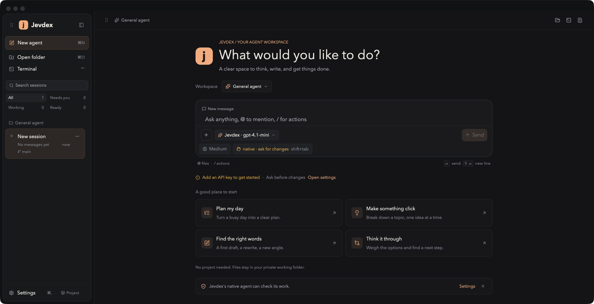
  <br /><small>Historical screenshot with legacy Jevdex branding.</small>
</p>

> [!NOTE]
> **Status: Early Preview.** macOS first, with experimental [Windows support](docs/WINDOWS.md). Native Windows runtime validation is still required; Linux is untested. Expect rough edges and breaking changes.

## Features

- **A coastal home dashboard.** Start with a panoramic, bundled background and
  the real task composer. See working sessions, recent conversations, your
  workspace, queued prompts and finished turns. The 14-day chart groups loaded
  conversations by their last-activity day, not individual commits or turns.
  Compact chat panels keep the composer and starter prompts instead of the
  dashboard. No PR, service or machine metrics are invented.
- **General-agent mode.** Open Hooter without a folder and ask questions, write,
  plan, or work on general tasks. No Git repository or project setup is needed.
  Created files live in the private `~/.flint/agent-workspace/` folder
  (`$FLINT_HOME/agent-workspace/` with a custom home). The native agent uses
  general-purpose instructions, with the existing approvals and sandbox rules.
  Choose **+ → General agent (no project)** to leave project mode, or open a
  folder when you need project files. Existing project conversations stay intact.
- **Its own agent.** A Chat Completions agent loop with tools: shell, read,
  write, edit and grep. It works with any OpenAI-compatible endpoint.
- **Subagents.** Hooter's native agent can delegate independent tasks to isolated,
  resumable child sessions, with up to four running in parallel. Choose a
  different default model in Settings, or let the agent select a model per task.
  Open **Subagents** beneath its parent in the sidebar to inspect a full,
  read-only conversation, including earlier work and resumed turns. Each child
  shows its model, live status and unread results, with independent scrolling.
  Search finds child tasks and models, including collapsed entries. Approvals
  still go through the parent, and **Back to parent** (or **Escape**) restores
  its draft. **⌘L** returns to the parent's composer. Expanded delegation cards
  also link to the child conversation. Direct child messaging and ACP child
  conversation discovery are not supported yet.
- **Native worktree tasks.** Ask the native agent to do isolated project work
  on a named branch. Its `spawn_agent` tool accepts `worktree.branch`, an optional
  `worktree.base` (default `HEAD`), and an absolute `worktree.repository` when
  working from general-agent mode. Hooter prepares a real Git worktree under
  its managed worktree folder, or reuses a clean linked checkout. It never
  switches the source tree, resets branches, or copies uncommitted source edits.
  Worktree access needs a separate approval, even in Auto-run mode.
  The child's shell, file tools, project instructions, and sandbox use that
  checkout; the parent's workspace stays unchanged. Results include the checkout
  path and branch. Resuming a child after restart retains its checkout and edits.
  Read-only requests do not create or open new worktrees. Primary, dirty, locked,
  and missing checkouts cannot be reused for a new child, and parallel children
  in one parent cannot share a checkout. Child diffs and checks stay separate
  from the source tree; parent Undo and parent-workspace MCP tools do not apply
  to an isolated child. Referenced child checkouts are protected in the picker,
  including archived conversations. ACP agents keep their own delegation rules.
- **Harness guard rules** that help cheaper models finish the job: loop
  detection, test-before-done checks, a watchdog for turns that edit nothing,
  and tool-call repair. An optional [JEV judge](#optional-jev-judge) can confirm
  the guard's suspicions.
- **Claude Code, Codex and Droid** as alternative agents over the
  [Agent Client Protocol](https://agentclientprotocol.com), using your own
  subscriptions.
- **Sessions.** Several run concurrently, are saved to `~/.flint/sessions/`, and
  are restored on launch. Long conversations are trimmed to a context budget.
  Drafts stay with their session. **Jump to latest** resumes following output
  after you scroll back.
- **Git branches and worktrees.** Click the branch in the header, or choose
  **Git branches & worktrees…** from the composer's `+` menu or command
  palette. Search local and remote branches, then **Open** one. Existing
  checkouts are reused; other branches open in isolated worktrees rather
  than switching underneath a running agent. Remote branches create a local
  tracking branch, or reuse the matching local tracking branch without
  pulling or resetting it. Name conflicts are reported, never overwritten.
  **Refresh** rereads local state; **Fetch remotes** explicitly fetches
  configured remotes, including GitHub, using your existing Git credentials.
  No extra token is stored, and no push, pull, or pruning is performed.
  Sign in through Git's credential helper or configure SSH outside the app
  if fetching reports an authentication error.
  To create a new branch, enter its name and a base branch or commit
  (default `HEAD`). New checkouts live
  under `~/.flint/worktrees/` (or `$FLINT_HOME/worktrees/`) and inherit the
  selected agent without moving the original session or its draft.
  Sessions, terminals, file mentions and edits use the selected checkout;
  worktrees still group under the same repository in the sidebar.
  Removal requires confirmation, refuses dirty or locked checkouts, and is
  disabled for checkouts referenced by sessions, archives or terminals.
  It never force-deletes a checkout or deletes its branch.
- **Prompt queue and steering.** Keep writing while the agent works.
  **Enter** or **Queue** adds a follow-up to the session's **Up next** tray;
  prompts run one at a time after successful turns. Edit, reorder, remove,
  pause or resume them without changing your current draft. Files and images
  are captured when queued, and pending prompts restore **paused** after restart.
  The queue holds up to 20 prompts and 32 MB of captured content.
  **Steer now** applies a queued instruction at the native agent's next model
  step without interrupting tools. With Claude, Codex or Droid, it stops the
  current turn and sends that prompt next instead. The composer's **Steer**
  button (or **⌘Enter**, when no approval is pending) applies a draft directly.
  **Stop** pauses pending work rather than starting another queued turn.
  Output sent from a tool card or terminal joins the same queue when busy.
- **Approvals.** Auto-run, or ask before changes; approvals are pinned above
  the composer (`y` approve, `a` approve always, `n` deny when the composer is
  empty).
- **Diffs.** A files-changed card per turn and a changes panel to review them.
- **File previews.** Click a local file link in an answer, or the eye button
  in Changes, to view it in the right-hand panel. Markdown is rendered;
  source and other UTF-8 text stay selectable and literal. Preview reads are
  limited to 512 KB; unavailable or unsupported files show an in-app message.
  Web links still open in your browser.
- **Dockable panels.** Drag the six-dot grip in the sidebar, chat, changes,
  or terminal header onto another panel's left, right, top, or bottom edge.
  Drag dividers to resize. The layout is saved to `~/.flint/layout.json`;
  **Reset panel layout** in the command palette restores the default.
- **Session panes.** Drag an actual session row from the sidebar onto the
  left, right, top, or bottom edge of the conversation or another session pane.
  Watch up to eight sessions side by side, resize their dividers, or use the
  grid button to arrange balanced rows. Each pane has **Chat**, **Terminal**,
  and **Both** controls, its own terminal tabs, and an independent draft.
  Fresh panes follow live agent commands; choosing a shell tab keeps that
  shell selected while the agent works.
  A sidebar click focuses a visible session or replaces the focused pane.
  Closing a pane keeps its session and terminals running; the expand button
  returns to one session. The layout and pane modes are saved in
  `~/.flint/session-layout.json`. After restarting, use **Open terminal** for
  a fresh shell; terminal processes and unsent drafts do not survive restart.
- **A terminal dock.** A real terminal (your shell, in the session's workspace)
  in tabs, docked at the bottom by default, with colours, scrollback,
  selection and links. Commands the agents run show up there too as read-only
  tabs; any command card can send its terminal to the agent, or its output
  back as a message.
- **`@` mentions** of workspace files, **`/` commands**
  (`/new`, `/clear`, `/model`, `/agent`, `/effort`, `/approval`, `/review`,
  `/help`) and a **command palette**.
  File indexing runs in the background. Text attachments use a bounded prefix
  of regular workspace files; changing a fresh session's project clears its
  relative file selections.
- **Image prompts.** Use **+ → Attach image…** to send up to four PNG, JPEG,
  GIF or WebP images (5 MB each), including files outside the workspace.
  Image prompts require a vision-capable model or ACP agent.

> [!TIP]
> **Limitations:** There is no light theme yet, and the thumbs up/down feedback on answers is only stored locally on your machine.

Native file tools refuse inputs above 8 MiB. Command approval is not a shell
sandbox: remembered command-prefix approvals apply only to allowlisted bare
`cargo` subcommands (`test`, `build`, `check`, `clippy`, `fmt`, `bench`);
other commands require an exact match.
Provider streams need a supported terminal completion before tools execute.
See [current gap-closure evidence and remaining limits](docs/GAP-CLOSURE-20261003.md).

## Architecture

One native workspace, two agent paths. Hooter renders its chat, changes and
terminal panels with GPUI (Metal on macOS), while the agent work runs
asynchronously.

<p align="center">
  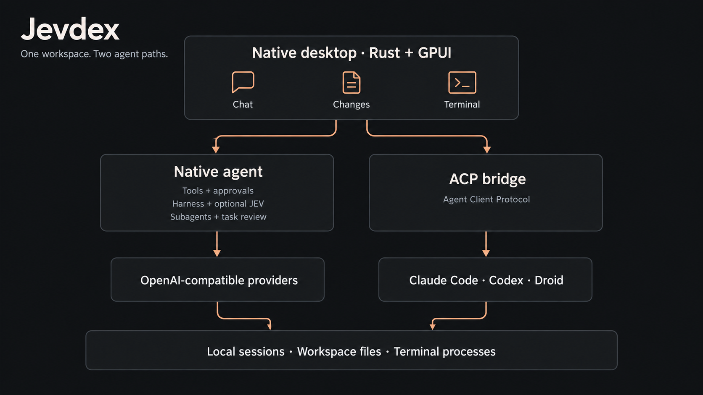
</p>

- **Native agent:** `flint-agent` owns the tool loop, approvals, harness,
  optional JEV judge and subagents. It connects to your configured
  OpenAI-compatible provider.
- **External agents:** `flint-acp` connects to Claude Code, Codex and Droid
  through the [Agent Client Protocol](https://agentclientprotocol.com).
  They keep their own models, tools, subscriptions and guardrails.
- **Shared workspace:** both paths surface conversations, file changes and
  command output in the same app. Settings and sessions stay local in `~/.flint/`.

> [!NOTE]
> For in-depth component specifications, sequence diagrams, and lifecycle flows, see [Architecture & Internals](docs/ARCHITECTURE.md).

### Turn Execution Lifecycle

The native agent combines context budgeting, streaming model output, guarded
tool execution and UI updates. External ACP agents manage their own turn loops.

<p align="center">
  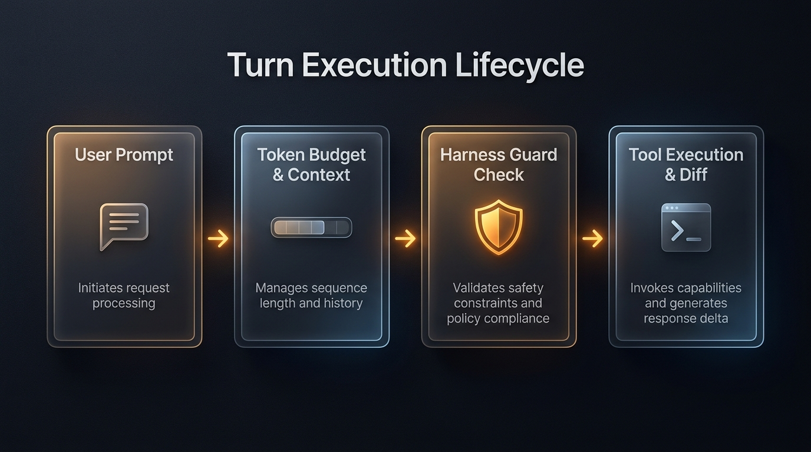
</p>

## Workspace & Interface

Hooter is designed around a responsive, low-latency macOS native interface powered by GPUI, combining modular dockable panels, a real PTY terminal dock, and an interactive changes reviewer.

### Dockable Panels & Dynamic Layout

Drag the six-dot grip on any panel header (Sidebar, Chat, Changes, or Terminal) onto another panel's top, bottom, left, or right edge to dock them side-by-side or stacked. Dividers can be dragged freely to resize panels.

<p align="center">
  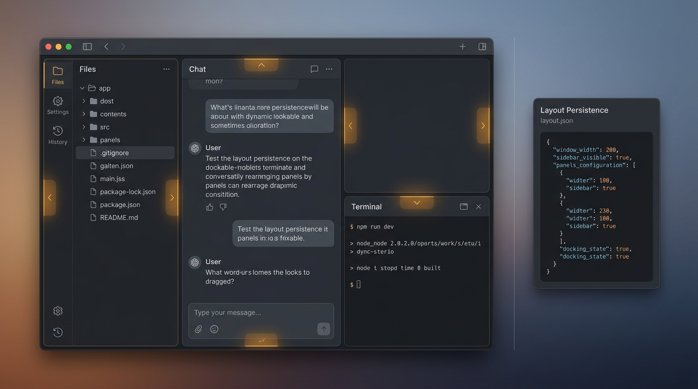
</p>

### Integrated Terminal Dock

The terminal dock embeds a full PTY shell session directly within your project workspace, complete with ANSI colours, full scrollback, and clickable links.

<p align="center">
  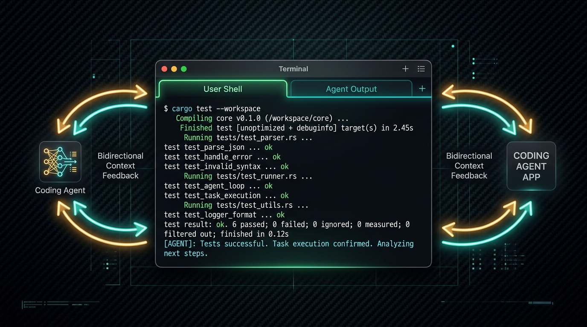
</p>

### Diffs & Changes Inspector

Review the agent's workspace edits turn-by-turn with syntax-highlighted unified
and side-by-side diff viewers before staging or committing work.

<p align="center">
  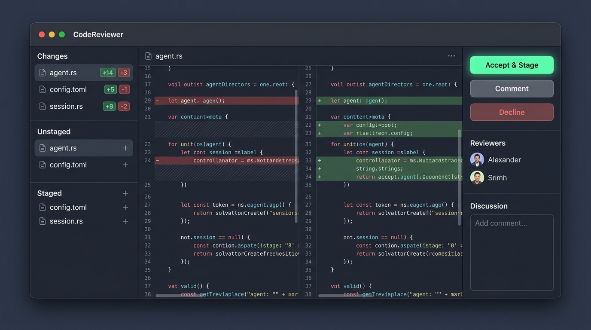
</p>

## Requirements

- Rust, pinned by [`rust-toolchain.toml`](rust-toolchain.toml); `rustup`
  installs it automatically.
- macOS with the Xcode command-line tools (`xcode-select --install`), which
  provide the Metal toolchain GPUI renders with.
- On Windows: Visual Studio 2022 C++ Build Tools and a Windows SDK, including
  `fxc.exe` for release builds. See [Windows setup and validation](docs/WINDOWS.md).

## Build and run

```sh
cargo run --release -p flint-app            # opens Hooter in general-agent mode
cargo run --release -p flint-app -- ~/code/my-project
cargo run -p flint-app -- --demo            # scripted demo, no model needed
```

The primary binary is `hooter`. The first release build takes several minutes.
The `jevdex` and `flint` binaries remain supported legacy aliases, as do
`/agent jevdex` and `/agent flint`. `/agent hooter` selects the native agent.

Hooter keeps the existing `~/.flint/` data directory, `FLINT_*` environment
variables, and Rust crate names. Existing settings and saved sessions do not
need to be moved or migrated.

On Windows, the same Cargo commands build `hooter.exe`; pass project paths such
as `"C:\code\my-project"`. Settings and sessions live in `%USERPROFILE%\.flint`.
Native commands use `cmd.exe`, and app shortcuts use **Ctrl** instead of
**Command**. Windows shell commands are **not sandboxed**.

## Configure a provider

Hooter talks to any OpenAI-compatible Chat Completions endpoint. With nothing
configured it uses `https://api.openai.com/v1` and `gpt-4.1-mini`; the model
and endpoint can be changed in Settings (`cmd-,`) or in the config file.

The API key is looked up in this order: an `api_key_file` or `api_key_env`
set in the config file or Settings, then the `FLINT_API_KEY` environment
variable, then `OPENAI_API_KEY`. The key is never shown or logged.
`FLINT_BASE_URL` and `FLINT_MODEL` override the endpoint and model for one run.

Settings live in `~/.flint/config.toml` (or `$FLINT_HOME/config.toml`):

```toml
model = "gpt-4.1-mini"
subagent_model = ""                   # empty inherits the parent model
base_url = "https://api.openai.com/v1"
api_key_env = "OPENAI_API_KEY"        # or: api_key_file = "~/.config/flint/key"
approval = "auto"                     # or "ask"
queue_after_verification = false       # opt in to advance queued work after passing checks
effort = "medium"                     # low, medium, high, or "" for the default
```

Other providers, changing only those lines:

| Provider | `base_url` | `model` (example) | Key |
| --- | --- | --- | --- |
| OpenAI | `https://api.openai.com/v1` | `gpt-4.1-mini` | `OPENAI_API_KEY` |
| DeepSeek | `https://api.deepseek.com/v1` | `deepseek-chat` | `api_key_env = "DEEPSEEK_API_KEY"` |
| OpenRouter | `https://openrouter.ai/api/v1` | `anthropic/claude-sonnet-4.5` | `api_key_env = "OPENROUTER_API_KEY"` |
| Ollama | `http://localhost:11434/v1` | `qwen2.5-coder` | any non-empty value, e.g. `FLINT_API_KEY=ollama` |
| Local server (llama.cpp, vLLM, LM Studio) | `http://localhost:8080/v1` | the name your server reports | any non-empty value |

Model names change often; check your provider's list.

### Subagents

<p align="center">
  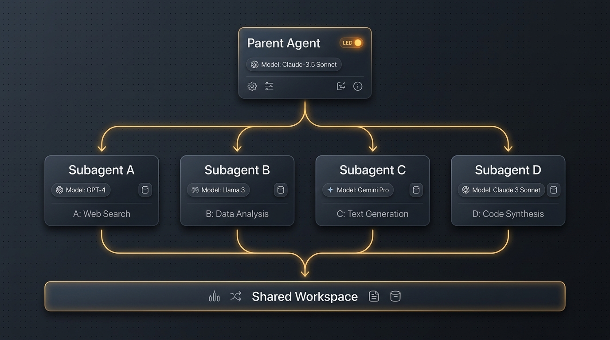
</p>

The native agent's `spawn_agent` tool follows Zed's delegation design: each child
has its own conversation, shares the workspace and approval mode, and returns
only its final answer plus a `session_id`. The parent can use that id for
follow-ups, including after a saved session is reopened. Children cannot spawn
more children. Interrupting a turn stops its children too.

Set **Subagent model** in Settings (`cmd-,`) or `subagent_model` in the config
file. `FLINT_SUBAGENT_MODEL` overrides it for one run. These settings apply when
a new Hooter engine session starts. Model selection for new children is:
explicit `spawn_agent.model`, then the configured subagent model, then the parent
model. Resumed children keep their original model and reasoning effort.

All models use the configured endpoint and API key. For models from different
vendors, use a multi-model gateway such as OpenRouter. The agent can call
`list_models` to discover exact ids; an unavailable explicit model returns an
error rather than silently falling back.

Consecutive independent `spawn_agent` calls in one model response run in
parallel (up to four at a time). Children edit the same workspace, not separate git worktrees,
so delegated edits must target different files. A parent retains up to 32 child
sessions; further tasks can resume an existing child. Claude Code, Codex and Droid
still use their own delegation implementations, not Hooter's tool.

### Approvals & Permission Security Gate

Hooter provides two execution modes configured via `approval`:
- **`auto` (Auto-Run):** The agent executes tools autonomously without interrupting you.
- **`ask` (Ask-Before-Changes):** Actions that modify files or run shell commands are paused for review.

When `ask` mode is active, approvals are pinned directly above the composer with dedicated single-key shortcuts:
- <kbd>Y</kbd>: Approve the current action.
- <kbd>A</kbd>: Approve always for the current session.
- <kbd>N</kbd>: Deny the action and return to the composer to redirect the agent.

<p align="center">
  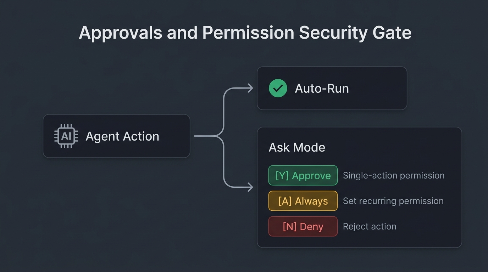
</p>

### Sessions & Context Token Budgeting

Hooter retains conversation history and automatically protects model context limits:
- **Local Persistence:** All conversations are durably saved to `~/.flint/sessions/<session_id>.json` and restored on app launch.
- **Context Budgeting:** When conversation length approaches the model's context ceiling, Hooter preserves the system instructions and recent turns while compacting earlier history into concise summaries.
- **Dynamic Grouping:** Organize your active sessions by **Project**, **Status**, or **Agent Type** via the session sidebar with <kbd>⌘</kbd> <kbd>⇧</kbd> <kbd>G</kbd>.

<p align="center">
  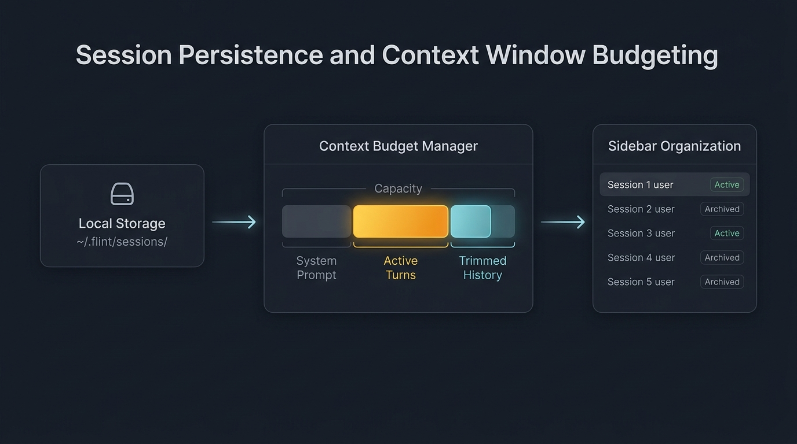
</p>

## Claude Code, Codex and Droid

<p align="center">
  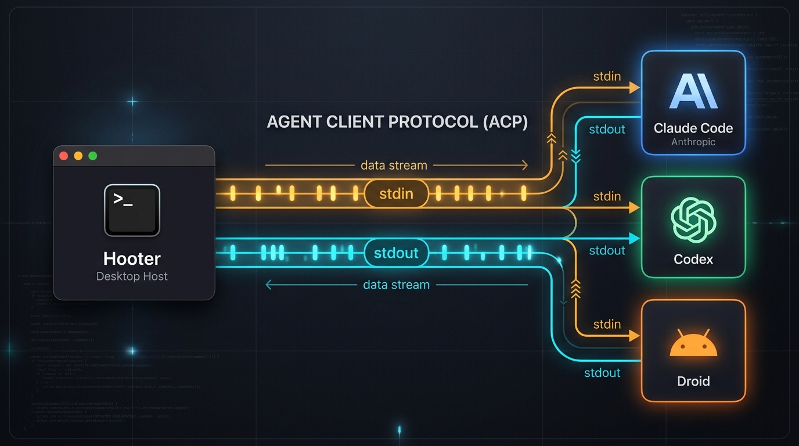
</p>

For Claude Code and Codex, install the ACP adapters, then sign in once with
each CLI so the adapter can reuse your login:

```sh
npm i -g @agentclientprotocol/claude-agent-acp
npm i -g @agentclientprotocol/codex-acp
claude    # log in once
codex     # log in once
```

Pick the agent for a session from the agent picker, with `/agent claude`,
`/agent codex`, `/agent droid` or `/agent hooter`, or from the command palette.
These agents run their own loops, so Hooter's harness guard rules do not apply
to them. They use your own agent accounts, not an API key from Hooter.

Droid speaks ACP natively, so it needs no adapter. Install Droid and sign in
once in a terminal:

```sh
npm i -g droid                      # or: brew install --cask droid
droid                              # log in to Factory
```

Choose **Droid** in the agent picker, type `/agent droid`, or use **New Droid
session** in the command palette. Hooter launches `droid exec --output-format acp`
and uses Droid's own model and mode options when it reports them. Droid runs
its own tools, settings, and subagents; Hooter's native `subagent_model` setting
does not change Droid's subagent models.

Claude Code prefers `ANTHROPIC_API_KEY` over a subscription login whenever it
is set, so Hooter removes `ANTHROPIC_API_KEY` and `ANTHROPIC_AUTH_TOKEN` from the
adapter's environment and Claude Code uses your plan. To bill an API key
instead, launch Hooter with `FLINT_CLAUDE_USE_API_KEY=1`.

The first message in a new Claude Code or Codex session can take 20–50 seconds
while the adapter starts.

## Keyboard shortcuts

On Windows, replace **⌘** with **Ctrl**. Workspace reveal opens File Explorer.

| Shortcut | Action |
| --- | --- |
| <kbd>⌘</kbd> <kbd>N</kbd> | New session |
| <kbd>⌘</kbd> <kbd>O</kbd> | Open a folder |
| <kbd>⌘</kbd> <kbd>K</kbd> or <kbd>⌘</kbd> <kbd>⇧</kbd> <kbd>P</kbd> | Command palette |
| <kbd>⌘</kbd> <kbd>L</kbd> | Focus the composer |
| <kbd>⌘</kbd> <kbd>.</kbd> | Interrupt the running turn |
| <kbd>⇧</kbd> <kbd>Tab</kbd> | Toggle auto-run / ask before changes |
| <kbd>⌘</kbd> <kbd>⇧</kbd> <kbd>A</kbd> | Toggle approval mode |
| <kbd>⌘</kbd> <kbd>J</kbd> | Toggle the changes panel |
| <kbd>⌘</kbd> <kbd>B</kbd> | Toggle the sidebar |
| <kbd>⌘</kbd> <kbd>⇧</kbd> <kbd>G</kbd> | Group sessions by project, status or agent |
| <kbd>⌘</kbd> <kbd>⇧</kbd> <kbd>R</kbd> | Reveal the workspace in Finder |
| <kbd>Ctrl</kbd> <kbd>`</kbd> | Show or hide the terminal dock |
| <kbd>⌘</kbd> <kbd>⇧</kbd> <kbd>T</kbd> | Open a terminal in the workspace |
| <kbd>⌘</kbd> <kbd>,</kbd> | Settings |
| <kbd>⌘</kbd> <kbd>Q</kbd> | Quit |

In the `@` and `/` menus: up/down to move, enter or tab to accept, escape to
dismiss.

## Harness Guard & JEV Judge

Hooter's native agent uses **harness guard rules** to catch repeated work,
missing verification and malformed tool calls:
- **Loop Detection:** Detects repeated cyclical tool invocation patterns and breaks out before tokens are wasted.
- **Watchdog:** Catches change requests with no observed work, while accounting for shell effects and checked deliverables.
- **Test-Before-Done:** Requires execution and verification of tests before concluding tasks that touched source files.
- **Tool-Call Repair:** Automatically repairs malformed JSON or invalid parameter signatures from cheaper models.

<p align="center">
  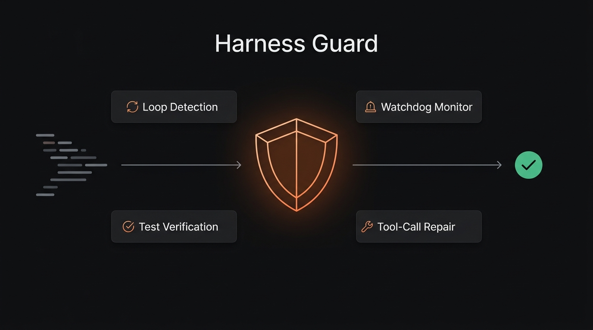
</p>

### Optional JEV judge

Set `TYPESAFE_API_KEY` to have the guard ask a Typesafe "JEV" judge to confirm
loop and verification suspicions instead of relying on heuristics alone.
The desktop app also reads `~/.flint/keys/typesafe.key` (or
`$FLINT_HOME/keys/typesafe.key`) when that environment variable is absent.
Keep the `keys` directory private (`chmod 700`) and the key file at `chmod 600`.
The key is never displayed in Settings and is only used for the JEV judge,
not as a fallback for the main model's credential.
`TYPESAFE_BASE_URL` and `JEV_MODEL` override its endpoint and model. Without
the key the harness uses its heuristics; Hooter works fine either way.
Use the **JEV** toggle beside the native chat options, or the
**JEV judge** toggle in Settings: even
with a credential present, `Off` keeps the harness on its own heuristics, and
`On` re-enables the judge. The setting lives in `~/.flint/config.toml` as
`jev_judge`. Changes apply on the next turn in native sessions, including
already-started engines and their resumed subagents. A running turn keeps
its configuration. JEV does not grant or remove edit permissions: task scope,
approvals, sandboxing, and deterministic completion checks remain active.
External ACP agents use their own guardrails.
When the judge rules, the transcript shows a `JEV` status row — what it judged,
its confidence, and whether the guard acted on the verdict.
Passing, current verification does not need another JEV verdict. The judge and
the completion guard use the same revision-aware check evidence. Routine
guard guidance stays in the work disclosure, with details available on demand;
unresolved blockers and failed outcomes remain visible.
Run dependency setup before final verification. An install or edit afterward
makes previous checks stale and triggers bounded recovery. Successfully
executed checks still count as recovery activity, but stale evidence never
certifies the current work. The UI distinguishes a repeated condition without
recovery progress from exhausting the four-follow-up budget and keeps the
unresolved condition in task details.

Queued work still waits for review by default. In Settings, opt into
**Continue queued work after passing checks** to advance after a native result
has current passing verification and no unresolved evidence issues. This does
not accept the result, change permissions or disable the sandbox. Partial,
blocked, interrupted and external-agent results still hold the queue, and
reloaded queues remain paused.

## Project layout

```
crates/flint-agent/   the agent engine: provider client, tools, harness, sessions
crates/flint-acp/     Claude Code, Codex and Droid over the Agent Client Protocol
crates/flint-app/     the GPUI app (binary: hooter; legacy aliases: jevdex, flint)
tools/blueprint/      evidence harness that drives the real app (Python + Swift)
```

The blueprint harness (`sweep.py`, `interact.py`, `live.py`, `perf.py`)
launches the app, takes screenshots and measures memory, CPU and start-up; see
[`tools/blueprint/README.md`](tools/blueprint/README.md). Its output goes to the
git-ignored `blueprint-out/`.

## Contributing

Issues and pull requests are welcome. Before sending a change:

```sh
cargo fmt --all
cargo clippy --workspace --all-targets -- -D warnings
cargo test --workspace
```

Tests never need a key or network access. The live tests in
`crates/flint-agent/tests/live.rs` are opt-in: set `FLINT_LIVE=1`,
`FLINT_API_KEY`, and optionally `FLINT_LIVE_BASE_URL` / `FLINT_LIVE_MODEL`.

For bounded task-completion benchmarks with independent grading, use the
[orchestrator evaluator](docs/ORCHESTRATOR-EVAL.md). Its offline mode needs no
provider credentials. Live subscription usage requires explicit authorization.

## License

Apache-2.0; see [LICENSE](LICENSE) and [NOTICE](NOTICE).
